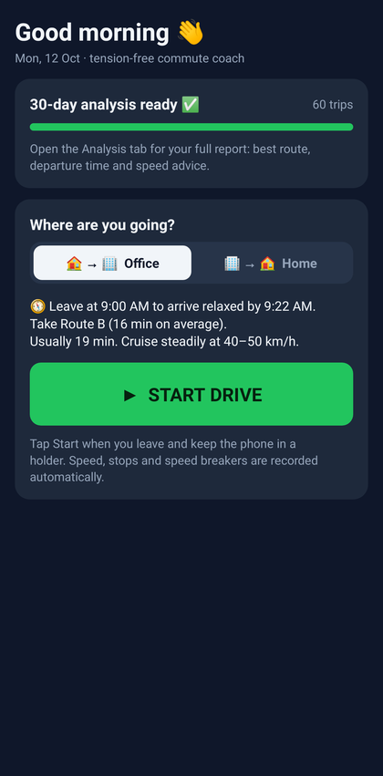
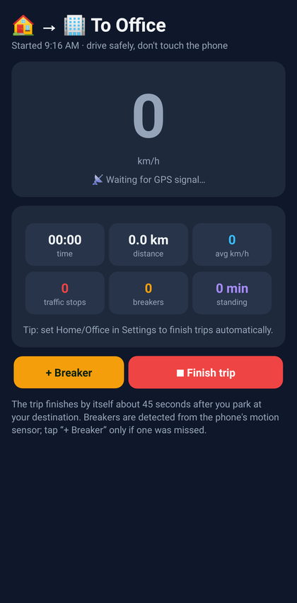
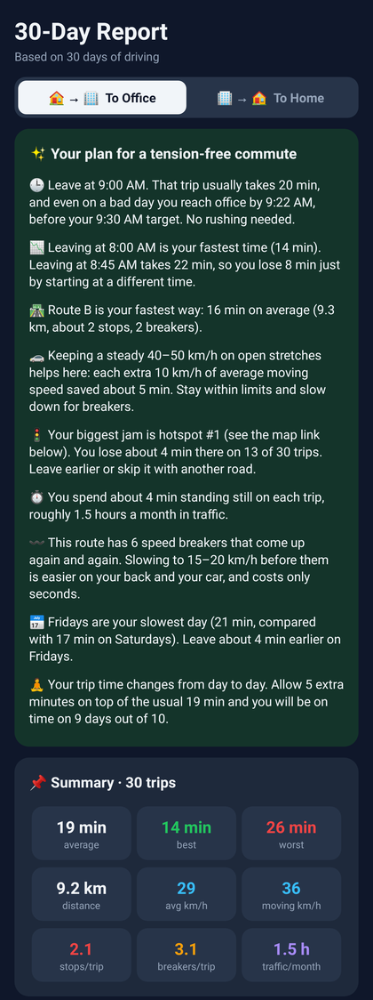

# Speed Analyst — commute tracker & 30-day analysis (Android)

Track every drive between **home and office**, and after **30 days** get a full analysis with
suggestions on **which route to take, when to leave, and what speed to drive** so you arrive on
time without stress.

<p>
  
  
  
</p>

## 📥 Download

**[SpeedAnalyst.apk](SpeedAnalyst.apk)** (in the root of this repository)

1. Open this repo on your phone → tap `SpeedAnalyst.apk` → **Download** (or "View raw").
2. Open the downloaded file. If Android asks, allow **Install unknown apps** for your browser or file manager.
3. Open **Speed Analyst** and allow **Location** (choose *Precise* and *While using the app*) and **Notifications**.

Works on Android 7.0 and newer.

## How to use

1. **Save Home and Office.** Stand at each place once and tap *I'm at Home* or *I'm at Office*
   (also in **Settings**).
2. **Every time you leave**, open the app, check the direction (🏠→🏢 or 🏢→🏠) and tap **START DRIVE**.
   Keep the phone in a holder.
3. The trip **finishes by itself** about 45 seconds after you park at the destination. You can also tap **Finish trip**.
4. Do this every day. The **Drive** tab shows *Day N of 30*.

## What it records

| Data | How |
|---|---|
| Route, distance, speed | GPS fix every second |
| Traffic stops 🚦 | Standing still for 15 seconds or more after the trip has started |
| Time stuck in traffic | Total time below 3.6 km/h |
| Speed breakers 〰️ | Vertical jolts from the accelerometer while moving. Sensitivity can be changed, and there is a manual **+ Breaker** button |
| Departure / arrival time | Trip start and end |

All data stays **on your phone** (SQLite). Nothing is uploaded.

## The analysis (Analysis tab)

Early insights appear after 3 trips in a direction. The full **30-Day Report** unlocks after 30 days of driving.

- **✨ Your plan for a tension-free commute.** Plain-language suggestions:
  - the **latest relaxed departure time**: leave at X and you still arrive before your target on a bad day (85th percentile trip time)
  - the **fastest route** and the **calmest route** (fewer stops and breakers, more predictable)
  - **speed advice**: how many minutes driving faster actually saved you, from a regression over your own trips, plus a steady cruising band
  - your **biggest traffic hotspot** and how much time you lose there
  - your **slowest weekday**, and how much **buffer** to keep so you are on time 9 days out of 10
- **Summary**: average, best and worst time, distance, speeds, stops, breakers, traffic hours per month.
- **Trip time day by day** (chart).
- **Departure time vs trip time**, in 15-minute slots (chart and table).
- **Your routes**: trips are grouped into Route A, B, C… automatically by comparing the roads you drove.
- **Traffic hotspots** (top 5) and **speed breakers**, each with a map link.
- **Average trip time by weekday** (chart).

Want to see it before you have 30 days of data? Use **Settings → Load 30 days of demo data**, and
remove it again with one tap.

## Building from source

The app is plain Java with no external libraries. It builds without Gradle or the SDK manager:

```bash
sudo apt-get install -y openjdk-17-jdk aapt apksigner dalvik-exchange zipalign python3-pil
./build.sh          # → SpeedAnalyst.apk
```

`build.sh` downloads the Android 14 framework jar from Maven Central, compiles resources with `aapt2`
and Java with `javac`, converts to DEX, then aligns and signs the APK with `signing/speedanalyst.keystore`.
Keep that keystore, because updates must be signed with the same key to install over an older version.

```
app/AndroidManifest.xml
app/res/                       icons, theme, strings
app/src/com/speedanalyst/commute/
  MainActivity.java            UI: Drive · History · Analysis · Settings
  TrackingService.java         foreground GPS + accelerometer service
  TripRecorder.java            live detection of distance, stops, breakers, arrival
  Analyzer.java                routes, departure slots, speed regression, hotspots, suggestions
  Db.java                      SQLite storage
  Charts.java                  bar, speed and route-shape charts
  DemoData.java                30-day sample generator
```
